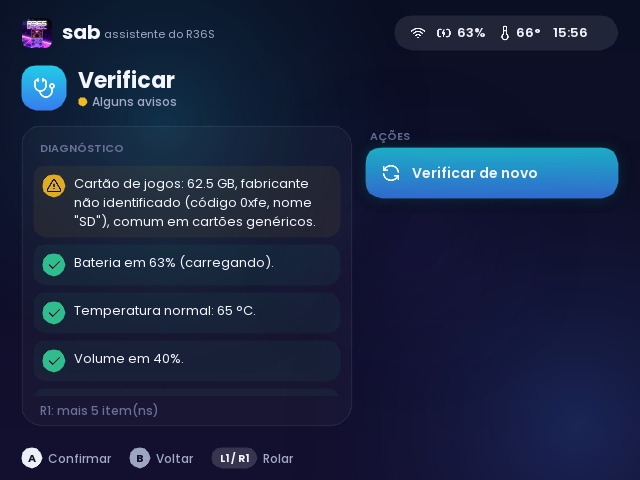
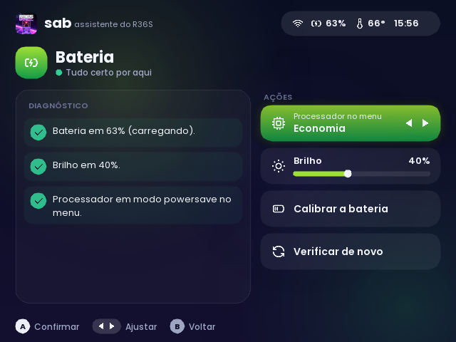
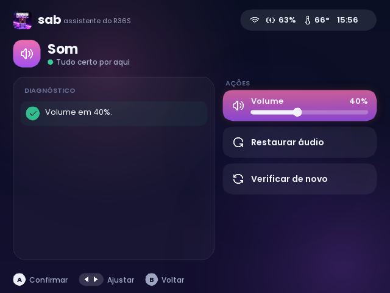
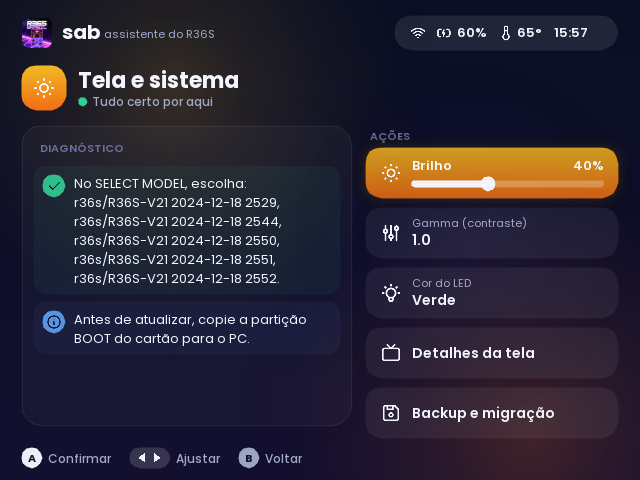
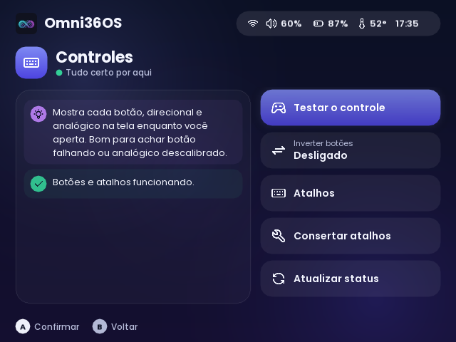
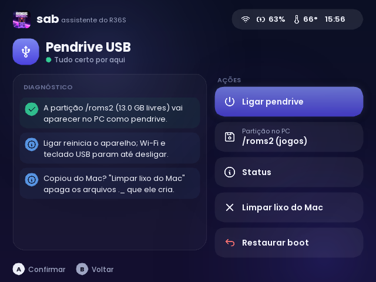
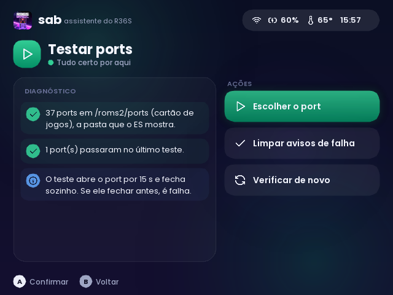
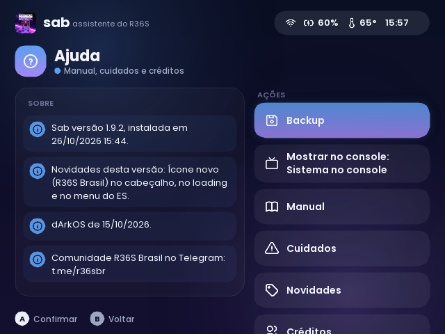

# Omni36OS: assistente do R36S

Port para o R36S com dArkOSen que verifica e ajusta o aparelho com um menu gráfico (Python 3 + SDL2 via ctypes, sem dependências extras). Não usa IA nem internet: são regras fixas em `omni_checks.py` e ações em `omni.py`.

## Instalação

1. Baixe o `Omni36OS-vX.Y.Z.zip` da [última release](https://github.com/mpjsilva/omni36os-r36s/releases/latest).
2. Extraia e copie **o `Omni36OS.sh` e a pasta `omni36os/` juntos** para a pasta de ports do cartão que o ES usa:
   - dois cartões: `/roms2/ports/` (cartão de jogos, na partição `EASYROMS`);
   - um cartão só: `/roms/ports/`.
3. No console, atualize a lista (Start > Configurações de jogos > Atualizar lista) ou reinicie, e abra **Ports > Omni36OS**.

Para atualizar, copie por cima: as configurações ficam em `~/.config/omni36os` e os resultados em `omni36os/logs`.

## Modos: port ou sistema

Na primeira execução o Omni36OS pergunta onde quer aparecer:

- **Lista de Ports**: o Omni36OS fica em Ports, como qualquer port. Nada muda no ES.
- **Sistema no console**: o Omni36OS ganha a própria entrada no menu principal do ES, com logo e ícone. Ele sai de Ports, um atalho é criado em `<cartão>/omni36os/Omni36OS.sh` e um bloco marcado é adicionado ao `es_systems.cfg` (backup em `es_systems.cfg.omni36os-bak`).

Para trocar depois: **Ajuda > Mostrar no console**. Ao fechar o Omni36OS, o ES reinicia uma vez para aplicar a troca, o ícone e a descrição.

## Tela inicial e atalho (branch `hub`)

- **Ajuda > Tela inicial do console**: um drop-in em `/etc/systemd/system/emulationstation.service.d/omni36os-hub.conf` troca o `ExecStart` do ES por `port/omni36os/hub.sh`. A ordem fica boot → Omni36OS → (B: Jogar) → ES → (sair do ES ou L3+R3) → Omni36OS. Desligar apaga o drop-in. Vale no próximo boot.
  - Segurar **B** no boot mantém o BaRT do dArkOSen; **L1** pula o Omni36OS; se o Omni36OS cair ao abrir, o ES sobe direto e o próximo boot pula o Omni36OS.
  - Um restart do serviço (troca de modo, importação do ES) vai direto ao ES (`/dev/shm/omni36os-hub-booted`).
  - "Só com alertas" roda `omni.hub_alerts()` (bateria ≤ 20%, ≥ 70 °C, serviço com falha, cartão cheio) em ~0,5 s.
- **Ajuda > Atalho L3+R3**: serviço `omni36os-atalho.service` (`port/omni36os/omni_atalho.py`) lê o `/dev/input` do controle. No menu do ES, fecha o ES (com o hub) ou para o ES num job do systemd (sem o hub) e abre o Omni36OS. No modo beta, num jogo, congela os processos do jogo (`SIGSTOP`), abre o Omni36OS e descongela ao fechar.

## Telas

| | | |
|---|---|---|
|  |  |  |
|  |  |  |
|  |  |  |
|  |  | |

## Estrutura

| Arquivo | Função |
|---|---|
| `port/Omni36OS.sh` | Atalho em Ports (modo port). No modo sistema ele sai de Ports e um atalho igual fica em `/roms2/omni36os/` |
| `port/omni36os/launch.sh` | Launcher de verdade. Não para o ES. Lê `/tmp/omni36os-next`: `test:<port>` roda o teste e reabre o Omni36OS (`OMNI_RESUME=testar`); `/opt/system/...` abre a ferramenta do dArkOSen. Reinicia o ES no fim se existir `/tmp/omni36os-restart-es` |
| `port/omni36os/omni_ui.py` | Interface: cards, páginas, tela de carregamento, leitor de textos |
| `port/omni36os/gfx.py` | Desenho com SDL2: caches de geometria, texto, sprites e camadas |
| `port/omni36os/omni.py` | Ferramentas que leem e mudam o sistema (`python3 omni.py` lista todas) |
| `port/omni36os/omni_checks.py` | Verificações de cada card e ações sugeridas |
| `port/omni36os/omni_backup.py` | Exportar e importar as configurações por módulo (`.tar.gz` com manifesto) em `/roms2/backup/omni36os` |
| `port/omni36os/omni_help.py` | Manual, cuidados, créditos e histórico de versões (NOVIDADES) |
| `port/omni36os/port_test.sh` | Teste de port: roda por 15 s; se o port fechar antes, gera o relatório em `omni36os/logs/<port>/` |
| `port/omni36os/usb_pendrive.sh` | Modo pendrive (gadget mass storage), instalado em `~/usb-disco.sh` |
| `port/omni36os/VERSION` | Versão instalada, mostrada no card Ajuda |

## O que o Omni36OS mexe no sistema

- `/etc/cpu-settings.conf` (GOV, FREQ), `/etc/gpu-settings.conf`, `/etc/dmc-settings.conf` e `/etc/gamma-settings.conf`: os mesmos arquivos que os serviços do dArkOSen aplicam no boot.
- `/usr/local/bin/perfnorm`, linha do governador: passa a ler o modo de `/etc/cpu-settings.conf`. O backup fica em `perfnorm.omni36os-bak`.
- `/usr/local/bin/fix_power_led` e `batt_life_warning.py`: cor do LED, copiadas das variantes `.red` e `.green`.
- `/boot/recovery.sh`: só ao pedir a verificação do cartão. O script do dArkOSen roda no boot e se apaga ao terminar.
- `/etc/emulationstation/es_systems.cfg`: no modo sistema, um bloco `<system>` entre os marcadores `<!-- Omni36OS ... -->`. O backup fica em `es_systems.cfg.omni36os-bak`.
- `~/.config/omni36os/modo`: `port` ou `sistema`.
- `port/omni36os/logs/`: relatórios de testes que falharam e `resultados.txt` (último resultado de cada port).
- `/boot/rk3326-r36s-linux.dtb`: só no modo pendrive. O backup fica em `.host-bak`.

## Lançar uma versão

1. Suba `port/omni36os/VERSION`.
2. Adicione a entrada no topo de `NOVIDADES` em `omni_help.py`.
3. Atualize `MANUAL` e `CUIDADOS` se algum card mudou.
4. Gere o zip: `cd port && zip -r Omni36OS-vX.Y.Z.zip Omni36OS.sh omni36os -x "omni36os/logs/*" "*__pycache__*"`.
5. Copie `port/Omni36OS.sh` para `/roms2/ports/` e `port/omni36os/` para `/roms2/ports/omni36os/`.
6. Faça um commit com a tag `vX.Y.Z` e publique a release com o zip.

Teste no PC: `OMNI_FAKE=1 python3 omni_ui.py` (dados de mentira). No console, use `SDL_VIDEODRIVER=offscreen OMNI_DEMO=...` para tirar prints sem parar o ES.
