

  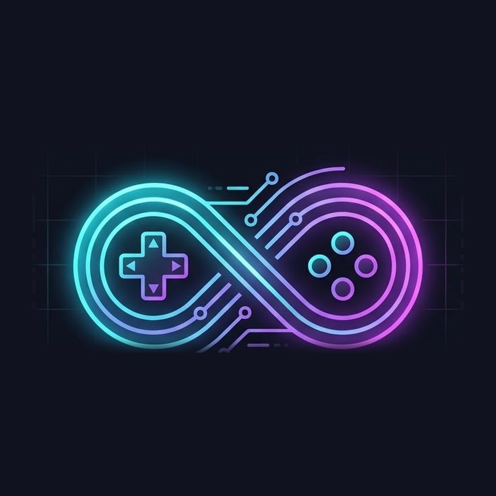

<h1 align="center">Omni36OS</h1>

  <b>Um sistema só de ports para o R36S</b>, com um launcher próprio, apps de mídia e cuidado do console num visual único. 
  Feito sobre o <a href="https://github.com/djparentx/dArkOSen-R36S">dArkOSen</a>, que por sua vez vem do <a href="https://github.com/christianhaitian/dArkOS">dArkOS</a> e do <a href="https://github.com/christianhaitian/arkos">ArkOS</a>.

  

---

## O que é

O Omni36OS transforma o R36S (RK3326) num console de **ports**: jogos de PC e homebrew portados para Linux ARM, como Stardew Valley, Celeste, Half-Life e muitos outros, instalados pelo [PortMaster](https://portmaster.games).

O EmulationStation sai de cena. No boot, sobe direto um launcher gráfico feito do zero, em Python 3 + SDL2. Ele abre os ports e toca músicas e vídeos. Também guarda notas, verifica a saúde do aparelho e reúne todas as ferramentas do sistema numa interface em português, pensada para os botões do console. Não é preciso teclado, PC nem terminal.

Versão atual: **1.15.3** · [Novidades de cada versão](NOVIDADES.md)

## Principais diferenciais

Em relação ao ArkOS, ao dArkOS e ao dArkOSen, que são sistemas excelentes e completos de emulação, o Omni36OS segue outro caminho:

| | ArkOS / dArkOS / dArkOSen | Omni36OS |
|---|---|---|
| **Foco** | Emulação de dezenas de sistemas + ports | Só ports (a biblioteca lê apenas as pastas `ports`) |
| **Interface** | EmulationStation com temas | Launcher próprio em cards (3×3), em pt-BR, com tema claro e escuro |
| **Ajustes** | Scripts separados em "Options/Tools", cada um com seu visual | Tudo dentro do launcher, com explicação de cada opção na própria tela |
| **Diagnóstico** | Manual | Cada card se verifica sozinho e mostra pontos de alerta; o conserto aparece com um botão ("SUGERIDO") |
| **Biblioteca** | Lista de arquivos | Capa, estúdio, data, gêneros e descrição de cada port (PortMaster, Steam, Wikipédia em português e DuckDuckGo, buscados uma vez e guardados no cartão) |
| **Apps** | — | Músicas (com visualizações e capa do álbum), Vídeos (codecs abertos do FFmpeg) e Notas (bloco de notas com edição contínua) |
| **Boot** | Telas pretas entre etapas | Logo e boas-vindas contínuos até o menu, com tudo no máximo durante o boot (cerca de 3 s a menos) e no mínimo depois |
| **Desempenho** | Governador fixo | Menu sempre no mínimo (esfria e poupa bateria); ports sobem até limites escolhidos; overclock com trava e senha |
| **Teste de ports** | — | Abre o port por 15 s, diz a causa provável da falha e corrige o que é seguro (com desfazer) |
| **Primeiro boot** | Escolher o DTB da tela à mão | Detecta a tela sozinho: testa os modelos possíveis e você só aperta um botão quando a imagem aparecer |
| **Teclado** | Teclado simples | Teclado no estilo do Android, igual em todo o sistema: maiúscula automática, caps lock com dois toques e símbolos no Y |

E mais:
- **Atalhos com FN dentro dos jogos:** contador de FPS com temperatura e bateria, limite de 30 FPS, captura de tela e fechar o jogo. O botão de power congela o jogo e abre o menu de energia por cima.
- **Energia segura:** desligar e reiniciar gravam tudo e desmontam o boot antes. Com bateria em 10%, o Omni36OS fecha o jogo dando tempo de ele salvar e desliga sozinho.
- **Rede pelo cabo USB, modo pendrive, Samba e navegador de arquivos com senha:** os serviços remotos só ligam com rede.
- **Calibração da bateria, backup das configurações, trava por senha e atualização pelo GitHub** com volta automática se a versão nova não abrir.

## Telas

| | | |
|:-:|:-:|:-:|
| 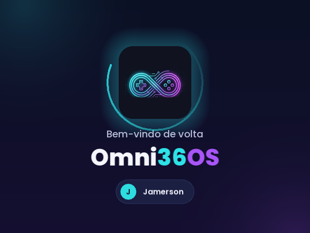 Boot contínuo |  Início | 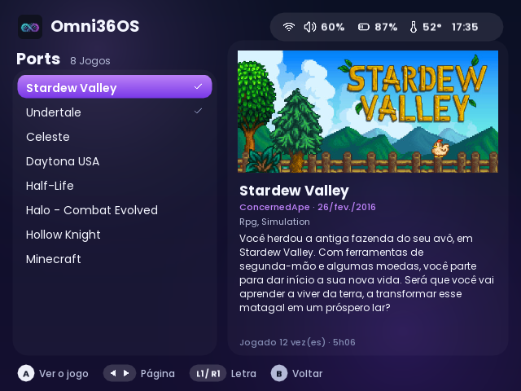 Biblioteca de ports |
| 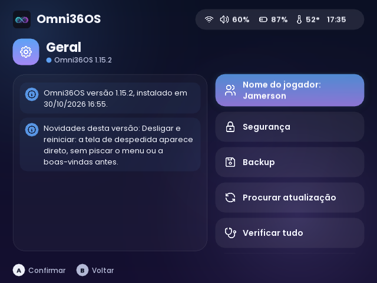 Tela e som | 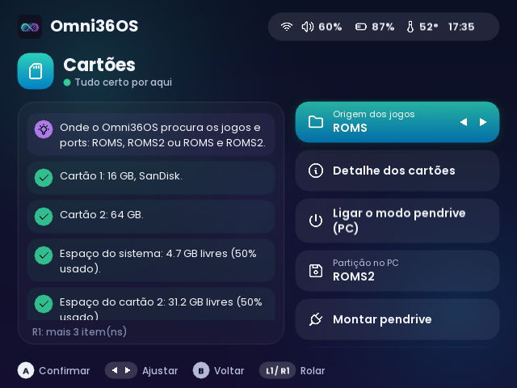 Rede | 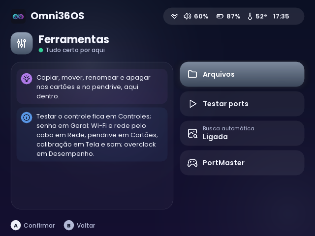 Controles |
|  Desempenho | 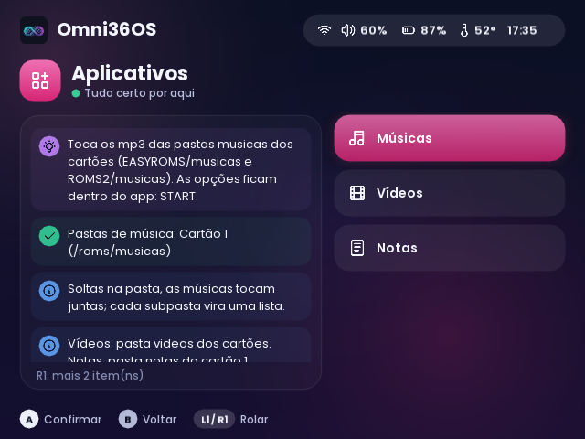 Cartões | 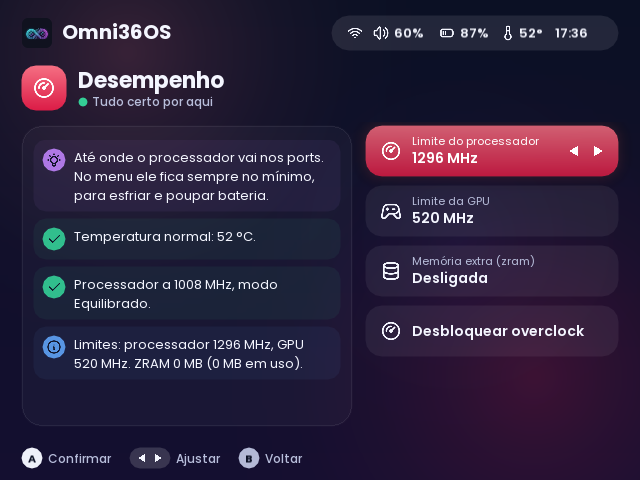 Ferramentas |
| 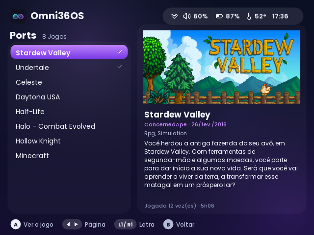 Geral | 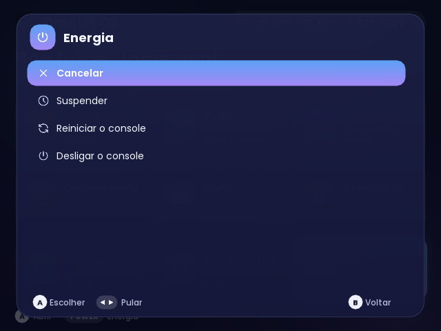 Energia | 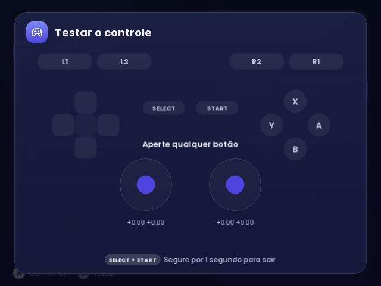 Testar o controle |
| 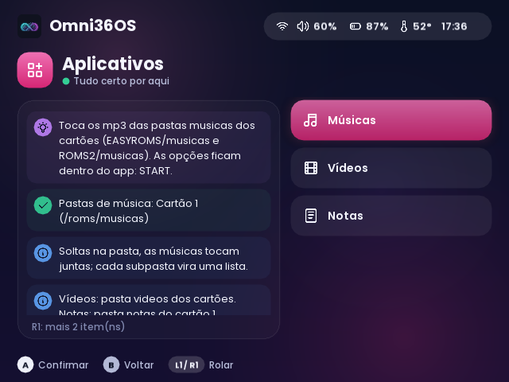 Aplicativos | 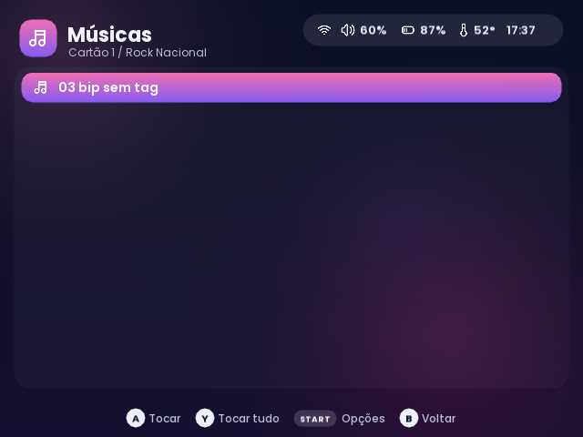 Músicas | 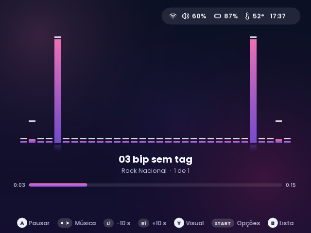 Visualização Barras |
| 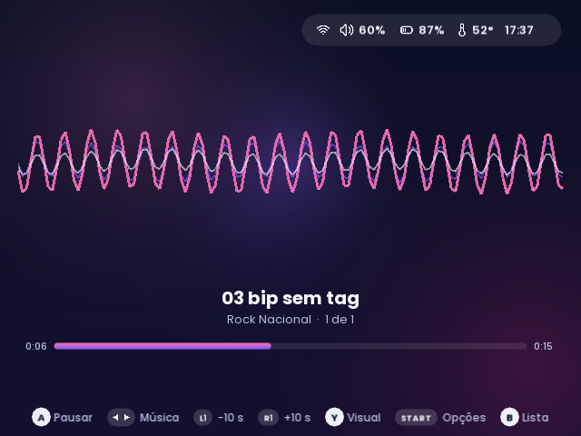 Visualização Ondas | 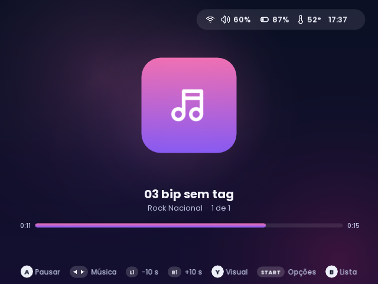 Capa do álbum | 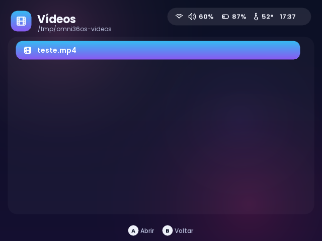 Vídeos |
| 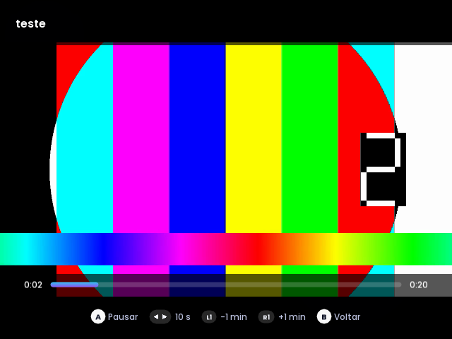 Vídeo tocando | 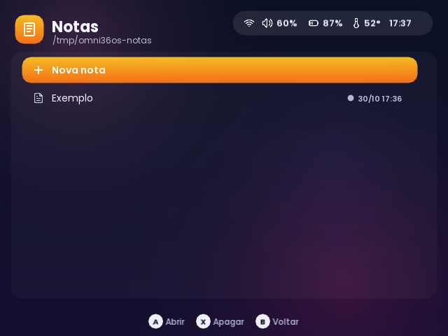 Notas | 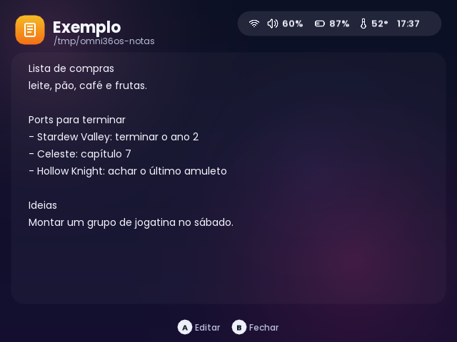 Lendo uma nota |
| 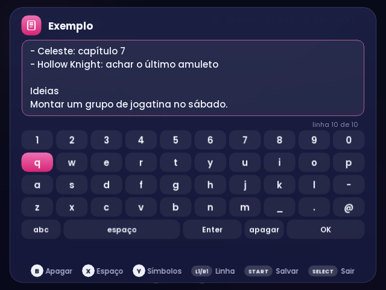 Editando (máquina de escrever) | 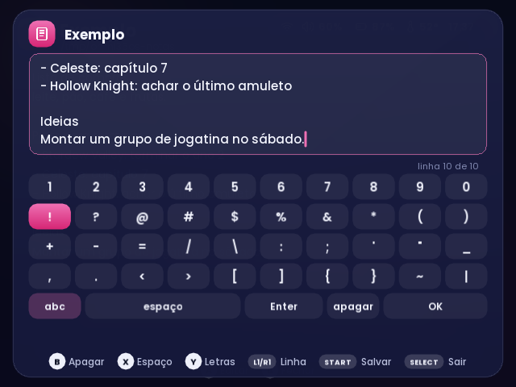 Teclado: símbolos | 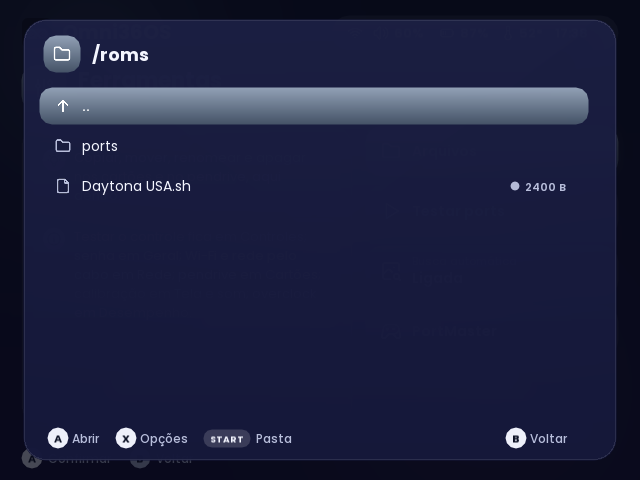 Arquivos |
| 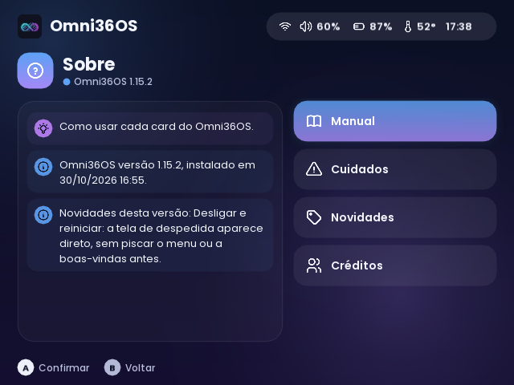 Sobre | 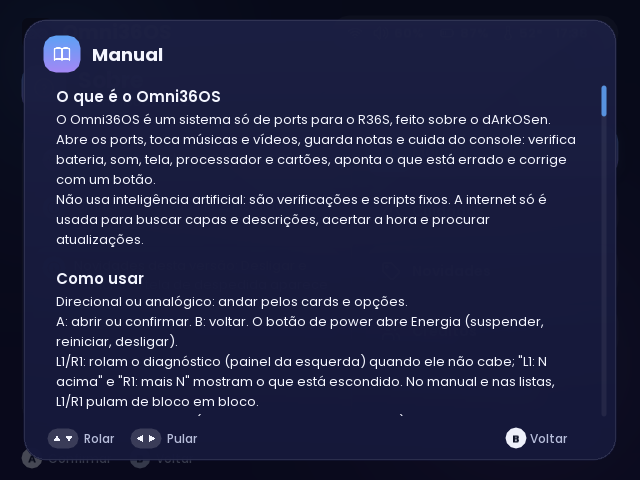 Manual no console | |

## Instalação

1. Baixe a imagem `Omni36OS-<versão>.img.xz` na página de [Releases](https://github.com/mpjsilva/omni36os/releases) e confira o SHA-256 (está no arquivo `.sha256` ao lado).
2. Grave num cartão microSD de 16 GB ou mais com o [balenaEtcher](https://etcher.balena.io), o [Raspberry Pi Imager](https://www.raspberrypi.com/software/) ou o Rufus. Os três aceitam o `.xz` direto.
3. Ponha o cartão no R36S e ligue.
   - **Tela certa:** se aparecer "Está vendo esta tela?", aperte qualquer botão. Se a tela ficar apagada, não desligue: o Omni36OS testa o próximo modelo de tela e reinicia sozinho.
   - **Preparação do cartão:** o primeiro boot expande o cartão e reinicia uma vez.
   - **Seu nome:** no fim, o Omni36OS pergunta como você quer ser chamado.
4. Instale ports pelo **PortMaster** (Ferramentas > PortMaster, com Wi-Fi) ou copie para a pasta `ports` do cartão.

Pastas no cartão (partição EASYROMS): `ports`, `musicas`, `videos`, `notas` e `imagens` (capturas de tela). Com um segundo cartão, `ROMS2` também é lido.

**Acesso pelo PC:** SSH e SFTP com `omni` / `omni`. Com "Serviços remotos" ligado, o Samba mostra Cartão 1 e Cartão 2, e o navegador de arquivos fica na porta 80, com o mesmo usuário. Troque a senha em Geral > Segurança.

> Feito e testado no **R36S original**. Clones com outras telas podem funcionar pela detecção do primeiro boot, mas não são o alvo.

## Controles principais

| Onde | Botão | O que faz |
|---|---|---|
| Menu | Direcional / analógico | Andar pelos cards e opções |
| Menu | A / B | Abrir ou confirmar / voltar |
| Menu | Power | Energia: suspender, reiniciar, desligar |
| Qualquer lugar | FN + Y | Captura de tela |
| Jogo | FN + X | Contador de FPS, temperatura e bateria |
| Jogo | FN + B | Limite de 30 FPS |
| Jogo | SELECT + START (1 s) | Fecha o jogo |
| Teclado | A, B, X, Y | Digitar, apagar, espaço, letras/símbolos |

Os atalhos se personalizam em Controles > Atalhos. O manual completo está no próprio console, em Geral > Sobre > Manual.

## Para desenvolvedores

- `port/omni36os/`: o launcher, que vai para `/opt/omni36os` no console. `omni_ui.py` é a interface, `gfx.py` o desenho em SDL2 via ctypes, `omni.py` o núcleo do sistema, e há um módulo por app (`omni_musica.py`, `omni_video.py`, `omni_teclado.py`).
- `imagem/gerar-imagem.sh`: monta a imagem de distribuição a partir da imagem original do dArkOSen. Tira o ES, o RetroArch e os emuladores e instala o Omni36OS e os arquivos de sistema.
- `tests/`: testes automáticos (`python3 tests/run.py`).
- **Simulador no PC:** `cd port/omni36os && OMNI_FAKE=1 OMNI_WINDOWED=1 python3 omni_ui.py`. Enter é A, Backspace é B, as setas são o direcional e F12 faz a captura de tela.
- Notas internas antigas: [docs/DESENVOLVIMENTO.md](docs/DESENVOLVIMENTO.md).

## Agradecimentos

O Omni36OS só existe porque muita gente boa fez o trabalho pesado antes. Muito obrigado a todos:

**Sistemas que serviram de base**
- **[ArkOS](https://github.com/christianhaitian/arkos)**, de [christianhaitian](https://github.com/christianhaitian): o sistema que deu vida aos portáteis RK3326, incluindo o kernel, o `ogage` (botões de brilho e volume) e os scripts de sistema que o Omni36OS ainda usa por baixo.
- **[dArkOS](https://github.com/christianhaitian/dArkOS)**, de christianhaitian: o ArkOS sobre Debian, base direta do dArkOSen.
- **[dArkOSen](https://github.com/djparentx/dArkOSen-R36S)**, de [djparentx](https://github.com/djparentx): a imagem usada como ponto de partida do Omni36OS, com o catálogo de DTBs dos modelos R36, a [ferramenta de calibração da bateria](https://github.com/djparentx/R36S-Battery-Calibration-Tool) (cuja ideia o Omni36OS reescreveu dentro do launcher), o patch do DTB de overclock e as correções de desligamento seguro e reparo do cartão.

**Ports e ferramentas**
- **[PortMaster](https://github.com/PortsMaster/PortMaster-GUI)** e toda a equipe e comunidade do PortMaster, pela loja de ports, pelos próprios ports e pelos dados e imagens dos jogos ([PortMaster-New](https://github.com/PortsMaster/PortMaster-New)).
- **[gptokeyb](https://github.com/PortsMaster/gptokeyb)**: o controle virando teclado e mouse nos ports.
- **[ogage](https://github.com/christianhaitian/ogage)**: as teclas de atalho do sistema.
- **[351Files](https://github.com/351ELEC/351Files)**: o gerenciador de arquivos de tela cheia do sistema base.
- **[File Browser](https://github.com/filebrowser/filebrowser)**: o navegador de arquivos pela rede.
- **[BatteryPlus](https://github.com/Mikhailzrick/knubat.components)**, de Mikhailzrick, que vem no dArkOSen.

**Bibliotecas e programas livres**
- **[SDL2](https://github.com/libsdl-org/SDL)**, SDL2_ttf, SDL2_image e [SDL2_mixer](https://github.com/libsdl-org/SDL_mixer) (licença zlib): tela, controles, fontes, imagens e músicas.
- **[FFmpeg](https://ffmpeg.org)** (LGPL/GPL): os vídeos.
- **[Debian](https://www.debian.org)**, o **Linux**, o NetworkManager, o Samba, o systemd e todo o software livre que roda por baixo.
- **Fonte [Poppins](https://github.com/itfoundry/Poppins)** (OFL), da Indian Type Foundry.
- **Ícones [Tabler](https://github.com/tabler/tabler-icons)** (MIT), de Paweł Kuna.

**Dados da biblioteca**
- **[Steam](https://store.steampowered.com)** (capas e descrições), **[Wikipédia](https://pt.wikipedia.org)** (descrições em português, texto sob [CC BY-SA 4.0](https://creativecommons.org/licenses/by-sa/4.0/)) e **[DuckDuckGo](https://duckduckgo.com)** (imagens, quando as outras fontes não têm).

**E a comunidade do R36S**, que documenta modelos, telas, clones e consertos em fóruns, wikis e grupos, e torna possível um projeto como este.

Feito por [mpjsilva](https://github.com/mpjsilva), com a ajuda do Claude (Anthropic) no desenvolvimento.
